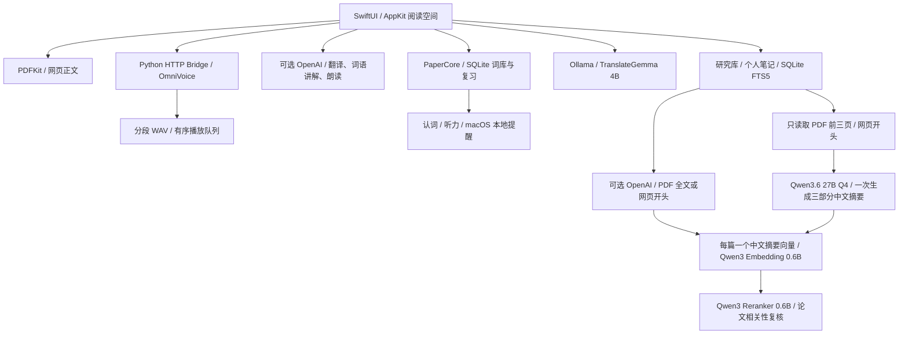

<p align="center">
  
</p>

# PaperLingo

**在真实英文论文阅读中学习英语的 macOS 原生应用。**

Read papers. Learn words in context. Listen and review locally.


[](LICENSE)

PaperLingo 将 PDF 与网页阅读、选词翻译、英文发音和间隔复习放在同一阅读空间。研究库可根据完整 PDF（OpenAI）或前三页文字（本地）整理研究动机、核心方法和实验结果，每篇用一份中文摘要建立本地检索索引。

首次安装默认使用本地服务。在「设置 → 模型服务」可分别设置翻译、摘要与生词讲解、朗读。每台 Mac 会记住自己的选择，重启后仍然生效。

[模型更新](#v031-模型更新) · [PDF 摘要对照](#pdf-摘要范围) · [快速开始](#快速开始) · [使用方式](#使用方式) · [项目架构](#项目架构) · [开发指南](docs/DEVELOPMENT.md) · [离线打包](docs/DISTRIBUTION.md) · [变更记录](CHANGELOG.md)

## v0.3.1 模型更新

| 在线功能 | v0.3.0 | v0.3.1 |
| --- | --- | --- |
| 选区翻译、生词语境讲解 | `gpt-4.1-mini` | `gpt-6-luna` |
| 研究库论文摘要 | `gpt-4.1-mini` | `gpt-6.2-sol` |
| 英文朗读 | `gpt-4o-mini-tts`（Speech API） | `gpt-realtime-2.1-mini`（Realtime API），按段发送文字并接收音频 |

本地模式继续使用 TranslateGemma 4B 翻译、Qwen3.6 27B 整理摘要和讲解生词，朗读可选 OmniVoice 或 macOS 系统语音。

### PDF 摘要范围

| 对照项 | OpenAI 全文摘要 | 本地前三页摘要 |
| --- | --- | --- |
| 模型读到什么 | 完整的原始 PDF，包括正文、图表和附录。文件中已有的批注和元数据也会随文件发送 | PDF 前三个物理页面中可提取的文字。封面和空白页也算一页，少于三页时读取现有页面 |
| 实验结果从哪里来 | 优先从实验章节和表格提取数据集、指标、比较对象和数值 | 只整理开头明确报告的结果。如果数值只出现在第 4 页或之后，摘要会注明开头未提供具体评测数值 |
| 使用条件 | 联网，PDF 须可打开且小于 50 MB。页面图像和文字计入 API 输入用量 | 安装本地研究模型，前三页须有可提取的正文。可离线生成 |

两种模式都生成一句话概括、研究动机、核心方法和实验结果，并建议分类与标签。研究库标明摘要的阅读范围。本地检索模型就绪后，每篇论文只用这份中文摘要建立一个向量索引。导入的是网页正文时，两种模式都取已保存正文的前 15,000 个字符。

切换到 OpenAI 后，原有的前三页摘要仍可查看和检索。要升级某一篇，在「研究库」打开论文并点击发送完整 PDF 生成摘要。要批量升级，使用顶部「＋」菜单，菜单会列出本次要发送的文件数量。只有主动开始生成才会上传。单独点击「更新摘要检索索引」只读取已保存的摘要。

## 功能

| 功能 | 行为 |
| --- | --- |
| 论文阅读 | 导入本地 PDF 或 HTTP(S) 链接，保留 PDF 图表、公式与双栏版式；保存阅读位置 |
| 选词与选句翻译 | 选区旁弹出翻译、朗读和更多操作，译文就地显示；保留所在句、论文来源与页码 |
| 朗读 | OmniVoice 私人参考音色、macOS 系统语音或 OpenAI 内置音色。支持分段、慢速、固定音色并清理数字引用与重复缩写 |
| 渐进朗读 | 长文本分段推理，首段完成即返回并播放，后续片段按序进入队列 |
| 专注阅读 | 左右面板独立隐藏，浮动工具栏自动收起，播放器不推移正文 |
| 个人词库 | 查询频率、原句高亮和来源跳转。Qwen3.6 或 OpenAI 生成简短语境讲解并保存在 Mac，可一键批量补全未处理词条 |
| 每日复习 | 到期词按不熟悉程度加权抽取，每组最多 20 项；切换页面保留词条、顺序、进度与揭晓状态，主动「换一组」才重新抽取 |
| 本地提醒 | 默认北京时间 20:30，可在设置调整；通知提供认词 / 听力入口 |
| 研究库 | 默认展示摘要；筛选与排序收进弹出面板，文献资料、分类、收藏及阅读状态按需编辑 |
| 个人笔记 | 想法、疑问、待办、复现记录；选区摘录与页码；Markdown 源码编辑与导出 |
| 中文摘要 | 在线读取完整 PDF 文件，本地读取前三页文字。固定整理研究动机、核心方法和实验结果 |
| 文献检索 | 每篇一个中文摘要向量，中英跨语言检索与本地重排；标题、资料、个人笔记另支持关键词检索 |

## 环境要求

- **Apple Silicon（M 系列）Mac，macOS 14 或更高版本**；当前完整模型安装与打包脚本面向 arm64。
- v0.2 全部模型建议 **32 GB 或以上统一内存**；目标设备为 M2 Pro / 32 GB。只使用 v0.1 翻译与语音功能可采用 16 GB 或以上配置。
- 首次从源码安装全部模型建议预留 **40 GB 或以上磁盘空间**；研究与重排模型共约 19.3 GB。同时保留运行环境、离线副本和 DMG 时需要更多空间，打包脚本会预检。
- 从源码构建需要 Xcode Command Line Tools（Swift 5.9+）和 `python3`；模型安装脚本会另外下载独立 Python 3.11.17。
- 首次下载模型和导入网页需要联网；本地 PDF、翻译、发音与复习可离线使用。

## 快速开始

### 配置 OpenAI（可选）

1. 在希望计费用量的 OpenAI 项目创建 API Key。已获赠额度的用户可先在对应 API 组织核对余额。[项目密钥](https://platform.openai.com/api-keys) · [用量](https://platform.openai.com/usage)
2. 在 PaperLingo 的「设置 → 模型服务」粘贴密钥，点击「保存密钥」。保存时只写入这台 Mac 的登录钥匙串。
3. 分别选择服务，也可以混合使用。首次使用可选中一个英文词点击「翻译」，或点击「试听一句英文」。这两个操作在对应服务选择 OpenAI 时会产生 API 用量。

在线翻译发送选中的词、短语或句子。生词讲解发送词条和附近的原句，批量补全时逐条处理。朗读分段发送清理后的文字，使用 OpenAI 内置音色，默认 Marin。论文摘要的发送范围见上方对照表。[OpenAI 模型目录](https://developers.openai.com/api/docs/models) · [文件输入与用量](https://developers.openai.com/api/docs/guides/file-inputs)

本地向量检索与重排可独立安装。只使用上述在线功能时，源码构建完即可打开 App。密钥可在设置中替换或从本机移除，服务端撤销需在 OpenAI 项目操作。

### 从源码运行

先安装 [Xcode Command Line Tools](https://developer.apple.com/xcode/resources/)，并确认 `swift --version` 与 `python3 --version` 可用。

```bash
git clone https://github.com/yuan1615/PaperLingo.git
cd PaperLingo

# 构建原生 macOS app，不下载模型
bash scripts/build-app.sh

# 首次安装两个模型及项目内运行环境，需要联网
bash scripts/setup-local.sh

# 安装研究与重排模型，共约 19.3 GB，支持中断后重新运行
python3 engine/install_research.py
python3 engine/install_reranker.py

# 打开 app，在设置中检查基础引擎与研究模型是否就绪
open dist/PaperLingo.app
```

下载中断后可以重新执行安装脚本，已有缓存和下载片段会复用。运行环境位于项目 `.runtime/`，不替换系统 Python。模型未安装时也能导入、阅读论文，并选择系统语音体验朗读。

亦可双击项目根目录的 `启动 PaperLingo.command`、`安装本地模型.command` 和 `安装研究模型.command`。开发版 app 依赖当前项目的 `.runtime/`；移动项目后请重新构建。

### 安装完整离线包

当前单独分发的完整离线包仍为 **v0.2.3**，不含 后续版本的阅读、复习、参考声音与在线服务更新，文件名为 `PaperLingo-0.2.3-macOS-arm64-offline.dmg`，约 **25.01 GB**。它包含 Python、Ollama，以及翻译、语音、论文摘要、向量检索和重排模型，无需开发工具或再次下载模型。双击 DMG，把 app 拖到「应用程序」，复制完成后推出镜像，再从「应用程序」启动。完整研究功能建议 32 GB 或以上内存，安装时预留至少 60 GB 磁盘空间。自行构建请参阅 [离线打包指南](docs/DISTRIBUTION.md)。

镜像超过 4 GB，传输用的移动硬盘或 U 盘请使用 APFS / exFAT，或通过 AirDrop、局域网传输。此前的 v0.1 离线包不含研究模型。GitHub Release 仍提供源码与说明，不托管这个完整模型镜像。

当前离线包采用 ad-hoc 签名，未做 Apple Developer ID 公证。首次若被 macOS 拦截，请按 [安装与迁移说明](packaging/INSTALL-zh.txt) 在「隐私与安全性」中允许打开。仓库的源码 ZIP 不是可直接安装的 app。

## 使用方式

1. 导入 PDF 或论文链接。arXiv 摘要链接会自动获取对应 PDF。
2. 在正文选中单词、短语或句子，松开鼠标后在选区旁点击「翻译」或「朗读」，译文直接显示在弹层中。更多菜单提供慢速、翻译所在句和保存笔记；成功翻译的单词与短语自动进入词库，句子通过「加入复习」保存。原文和译文可独立滚动到末尾；滚动正文、拖动滚动条或调整窗口会保留结果。点击别处或按 Esc 收起弹层，专注模式也可使用。
3. 阅读时收起侧栏或进入专注模式，浮动播放器支持暂停、继续、收起和停止。
4. 打开「生词本」，先显示原有译文，本地模式会为当前展开的单词或短语生成「本句词义 / 结合原句 / 用法提示」。已有讲解直接显示，可取消或重新生成。点击「一键补全」可串行处理整个生词本中尚无有效讲解的单词和短语，不受搜索或筛选影响，自动跳过已有讲解和整句。界面显示成功、失败与总进度；本地模式下单项失败继续下一项，在线批量遇错即停，再次点击只补未完成项。取消或离开生词本会停止任务并保留已完成结果。新原句或提示词版本变化会使旧讲解失效。
5. 打开「今日练习」，先回想含义或听音辨认，再揭晓答案，并用「忘记 / 模糊 / 记住 / 轻松」评分。长原句可在卡片中完整滚动查看；旧词条会尝试从保存的来源页恢复原句，评分按钮固定在卡片外。原句中的当前单词或短语以浅黄色底色和加粗突出，忽略大小写并标记重复出现处。词条发音旁的绿色「朗读原句」按钮播放完整上下文；进度栏中的播放器支持暂停、继续、停止和按需查看详情，播放状态变化不改变卡片大小和滚动位置。
6. 在设置中授权 macOS 通知，调整每日复习时间、音色和语速。
7. 打开「研究库」默认查看论文摘要，顶部提供搜索、筛选与导入。详情的「资料」与更多菜单可编辑研究方向、保留理由和阅读状态；「笔记」独立保存个人记录。读原文时用 `⇧⌘N` 把当前选区与页码附入笔记。
8. 点击详情中的摘要生成按钮。在线 PDF 按全文整理，本地 PDF 使用前三页，网页使用开头文字。摘要固定包含研究动机、核心方法和实验结果；可采用建议分类与标签，个人笔记独立保留。
9. 本地检索模型就绪时，摘要生成后会建立一个中文摘要向量。输入关键词立即搜索，或点击「按意思查找」，例如“多语言零样本语音合成”。未生成摘要的论文暂只参与关键词检索。

本地模型一次生成固定结构的摘要，完成后卸载，再加载小型向量模型。整理期间仍可阅读、写笔记、按关键词检索和使用系统语音。[摘要提示词](Sources/PaperCore/PaperSummary.swift)

本地词语讲解复用已有 Qwen3.6 27B，不新增模型下载。关闭思考模式，约 100–180 字，长原句只取选词附近最多约 1,200 字符。讲解让位于翻译、朗读、论文整理和语义检索，单次模型请求最多 45 秒。连续批量处理复用已加载模型，完成、取消或被前台任务打断时卸载；仍在生词本时，被打断的批量任务在前台空闲后继续。进入今日练习不触发新讲解。首次升级到数据库 schema 5 会先保存一致备份，再增加独立讲解缓存，不重写词条翻译、查阅次数或评分。

查询频率只在主动查阅时累计；改变选区不会反复计数。今日练习从全部到期词中加权随机抽取，每组最多 20 项且不重复；遗忘多、查阅频繁、掌握阶段低和逾期的词更容易出现，其他到期词也有机会。当天首次进入练习会建立一组，切换页面再回来继续当前词条、顺序、进度、模式与揭晓状态；切换认词/听力只改变模式并隐藏答案。点击「换一组」或完成后的「继续下一组」重新抽取；跨日重新进入会建立当天的新组，退出 App 后练习组不持久化。未到期词不提前加入，「忘记」后仍等待 10 分钟再复习。

自定义声音素材与逐字文本放在忽略的 `.runtime/voice-prompts/` 中，构建时随本机 app 携带，不上传 GitHub。可在 **设置 → 模型服务 → 发音人** 选择素材并试听；切换会停止当前播放与待合成片段，下一次朗读使用新声音，无需重启引擎。选择会在退出 App、重启和模型调度后保留；升级时沿用上次使用的编号，没有有效编号时固定选择清单第一项。单词与长文所有片段都使用选中的参考声音。未配置素材的源码构建继续使用模型的美式/英式声音设计模式；系统语音独立使用 macOS 音色。口音与性别需素材标签确认。

朗读只处理一份播放副本：省略 `[2]`、`[2, 4–6]` 等数字引用，以及紧接英文全称的重复括号缩写，如 `large language models (LLMs)`；独立选中的缩写、实验条件、普通说明、特殊 token 和可识别的数组/公式语境保留。排版换行合并为空格，修复断词、软连字符和常见 PDF 连字，保留常见复合词中的连字符。生词与原句显示也使用排版修复；旧词条按需从保存的来源页或网页恢复完整原句，过程不重写历史学习记录。

### 快捷键

| 快捷键 | 操作 |
| --- | --- |
| `⌘O` | 导入 PDF |
| `⇧⌘O` | 导入链接 |
| `⇧⌘F` | 进入 / 退出专注阅读 |
| `Esc` | 先收起选区弹层；无弹层时退出专注阅读 |
| `⌥⌘S` | 显示 / 收起论文库 |
| `⌥⌘I` | 显示 / 收起学习助手 |
| `⌘L` | 朗读选区 |
| `⌘.` | 停止播放 |
| `⇧⌘K` | 打开研究库 |
| `⇧⌘N` | 为当前论文新建笔记并附入选区 |
| `⌘S` | 在笔记编辑器中保存 |

## 项目架构



- **界面**：SwiftUI + AppKit；PDFKit 展示论文，NSTextView 展示提取后的网页正文。
- **学习数据**：SQLite 保存论文元信息、词条、查询与复习事件；透明的规则式间隔算法，尚未使用 FSRS。
- **翻译**：URLSession → `127.0.0.1:11434` → Ollama `translategemma:4b`（Q4_K_M）。
- **语音**：URLSession → `127.0.0.1:8765` → OmniVoice 0.2.1 / PyTorch MPS。推理串行执行，客户端播放与下一段推理并行。
- **分段协议**：`POST /speak/stream` 输出 NDJSON，依次返回 `start → audio → … → done`；支持取消与片段缓存。
- **研究模型**：Ollama `qwen3.6:27b-q4_K_M`，16K 上下文、关闭思考、一次请求返回固定 JSON；包含一句话回顾、研究动机、核心方法、实验结果及建议分类标签。异常长的前三页会明确报错，不默默截断输入。
- **论文索引**：`qwen3-embedding:0.6b`，每篇一个向量，输入严格为中文摘要的一句话回顾与三部分正文。原文、标题、分类、标签和个人笔记均不加入向量。笔记或文献资料修改不使向量失效；摘要变动才重建。旧版摘要需重新生成。
- **相关性复核**：摘要向量与摘要关键词召回融合后，以本机 `Qwen3-Reranker-0.6B` 重排并过滤弱相关论文；摘要未涵盖的细节可能检索不到，可直接打开论文核对。

本地 OmniVoice 首段上限 120 字符，后续每段上限 160 字符，单次最长 12,000 字符。分段缩短开始聆听的等待；模型首次加载、机器负载和文本长度仍会影响延迟，片段之间可能出现等待。

```text
Sources/
  PaperLingo/             原生界面、阅读器、音频与模型进程管理
  PaperCore/              数据库、文本规则、复习算法、运行时路径
  CSQLite/                SQLite 系统模块
engine/                   OmniVoice HTTP 服务、下载与诊断工具
engine/tests/             无需模型的 Python 回归检查
Tests/PaperCoreTests/     可独立运行的 Swift 核心检查
scripts/                  构建、环境安装与离线打包
packaging/                图标、Info.plist、安装说明及第三方许可
docs/                     产品设计、开发、分发与验收记录
.github/                  未启用的 CI 示例、Issue 表单与 PR 模板
```

## 数据与隐私

| 内容 | 位置 |
| --- | --- |
| 论文、词库、查询与复习记录 | `~/Library/Application Support/PaperLingo/` |
| 开发版模型、Python、日志和音频缓存 | 项目 `.runtime/` |
| 离线安装版模型与运行环境 | `PaperLingo.app/Contents/Resources/Runtime/` |
| 离线安装版可写日志与缓存 | `~/Library/Application Support/PaperLingo/Engine/` |

本地模式在 Mac 上推理。启用某项在线服务后，App 通过 HTTPS 或加密 WebSocket 直接请求 `api.openai.com`，拒绝重定向。在线生词讲解需要点击生成或批量补全。在线请求失败时显示原因，由用户决定是否重试或切换服务。

密钥只用于请求鉴权，存放在禁止同步的钥匙串项目中。学习数据库、导出文件、引擎日志和分发包均不写入密钥。在线 PDF 摘要会随一次请求内联发送原文件，统一使用 `paper.pdf` 作为传输文件名。文件自带的内容和元数据也会发送。单独保存在研究库的个人笔记、档案以及私人参考音频留在 Mac。打开研究库或切换服务不会触发上传，旧的开头摘要保留至主动重新生成。文本请求设置 `store: false`。服务端的滥用监测日志仍受 OpenAI 的数据保留规则约束。[OpenAI 数据控制说明](https://developers.openai.com/api/docs/guides/your-data)

首次升级 v0.2.2 会先用 SQLite 在线备份 API 保存一致数据库到 `Backups/library-before-v0.2.2-*.sqlite`，再以事务清理旧实验台账、核对记录、全文缓存和旧向量。原论文、词库、复习记录、阅读位置与个人笔记保留；历史摘要可查看，需重新生成才能进入新向量索引。升级备份供恢复旧数据使用，不参与新功能。旧版 app 不应打开新版数据库。

迁移前先在两台电脑退出 app，再复制完整用户数据目录；可跳过 `Engine/` 缓存，存在的 SQLite `-wal` / `-shm` 辅助文件须一并保留。新机已有数据时先备份。JSON 导出版本为 5，包含词库、文献档案、个人笔记与最新摘要；不含实验记录、PDF、完整日志或向量，没有 JSON 导入。

## 开发与验证

以下检查无需下载模型：

```bash
swift run --disable-sandbox PaperCoreChecks
python3 -m unittest discover -s engine/tests -v
bash scripts/build-app.sh
```

仓库附带 [macOS CI 模板](.github/ci.example.yml)，启用方法见开发指南。检查不下载权重，也不把模型质量测试当作已通过。本地三页摘要与索引的验收见 [v0.2.2 验收记录](docs/VERIFICATION_V0.2.2.md)；历史结果见 [v0.2.1](docs/VERIFICATION_V0.2.1.md)、[v0.2](docs/VERIFICATION_V0.2.md) 和 [v0.1](docs/VERIFICATION.md)。

环境变量、真实模型诊断和代码约定见 [开发指南](docs/DEVELOPMENT.md)。完整 app / DMG 的构建、签名和分发方式见 [离线打包指南](docs/DISTRIBUTION.md)。

## 当前边界

- 本地划选与本地摘要需要 PDF 文字层。OpenAI 全文摘要可以读页面图像与表格，效果受清晰度和模型上下文上限影响。关键数值请对照 PDF 核实。
- 网页提取适用于静态正文；登录墙、反爬或动态网页可先由浏览器打印为 PDF。
- 三页摘要刻意省略后文细节；AI 可能误解作者主张，重要结论、数值与限定条件应回到原文核对。
- 翻译与发音可能有误，孤立学术术语需结合原论文核对。
- 通知受 macOS 授权、休眠与专注模式影响；未来 30 天的提醒会在打开或学习后重新安排。
- 尚无跨设备同步、口语评分、全篇自动翻译、OCR 或个人模型训练。

## 参与贡献

欢迎通过 [Issues](https://github.com/yuan1615/PaperLingo/issues) 报告问题或提出建议，提交代码前请阅读 [CONTRIBUTING.md](CONTRIBUTING.md)。安全问题请按 [SECURITY.md](SECURITY.md) 私下报告。

[产品与交互设计](docs/PRODUCT.md) · [变更记录](CHANGELOG.md) · [源码 MIT 许可证](LICENSE)

## 许可与致谢

**PaperLingo 自有源码采用 [MIT License](LICENSE)**。这不改变第三方代码、模型权重、音频 tokenizer 或依赖的许可证，也不授予模型的额外商用权利。

| 组件 | 上游与许可 |
| --- | --- |
| OmniVoice 代码 | [k2-fsa/OmniVoice](https://github.com/k2-fsa/OmniVoice)，Apache-2.0 |
| OmniVoice 权重 | [模型卡](https://huggingface.co/k2-fsa/OmniVoice)，CC-BY-NC；当前完整模型包面向个人非商业学习 |
| TranslateGemma 4B | [Google / Ollama](https://ollama.com/library/translategemma)，Gemma Terms of Use 与 Prohibited Use Policy |
| Higgs Audio V2 tokenizer | Boson AI 社区许可，随 OmniVoice 快照分发 |
| Ollama | [ollama/ollama](https://github.com/ollama/ollama)，MIT |
| Qwen3.6 27B | [Qwen 官方模型卡](https://huggingface.co/Qwen/Qwen3.6-27B)，Apache-2.0；Ollama Q4_K_M |
| Qwen3 Embedding 0.6B | [Qwen 官方模型卡](https://huggingface.co/Qwen/Qwen3-Embedding-0.6B)，Apache-2.0 |
| Qwen3 Reranker 0.6B | [Qwen 官方模型卡](https://huggingface.co/Qwen/Qwen3-Reranker-0.6B)，Apache-2.0；本机相关性复核 |

详细归属、固定模型版本和随包许可见 [THIRD_PARTY_NOTICES.md](THIRD_PARTY_NOTICES.md) 与 [packaging/third-party/](packaging/third-party/)。感谢上述项目的作者和维护者。
