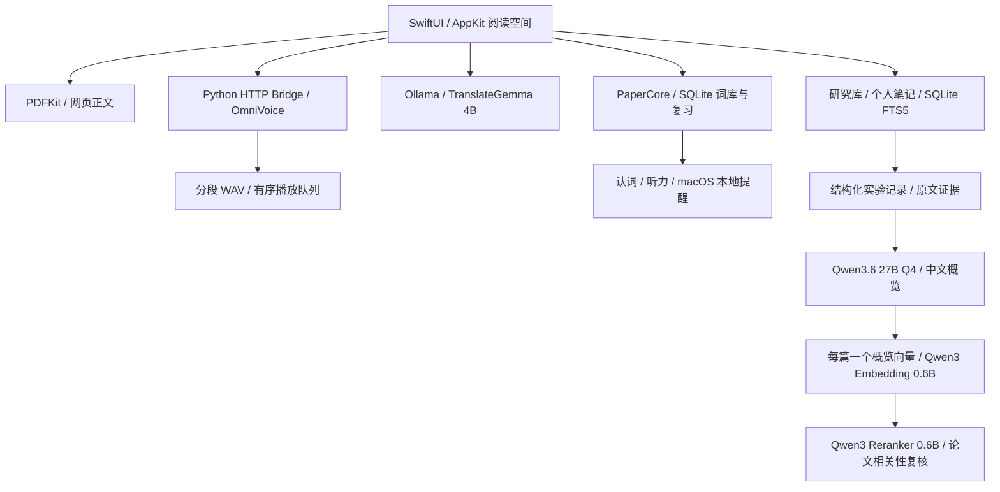

<p align="center">
  
</p>

# PaperLingo

**在真实英文论文阅读中学习英语的 macOS 原生应用。**

Read papers. Learn words in context. Listen and review locally.


[](LICENSE)

PaperLingo 将 PDF / 网页阅读、选词翻译、英文发音和间隔复习放在同一阅读空间。v0.2 新增研究库：按分类整理文献、保留个人笔记、生成带原文证据的中文汇总，并用中文描述检索英文论文。翻译、发音、整理和语义检索均使用本地模型。

当前开发版本为 **v0.2.1**，设计与实施范围见 [实验与证据改进](docs/V0.2.1_PLAN.md) 和 [v0.2 规划](docs/V0.2_PLAN.md)。本仓库提供源码、模型安装和离线打包脚本；**不包含模型权重、Python 运行环境、DMG 安装包或个人学习记录**。此前分发的 v0.1 离线包不含研究模型，不能替代 v0.2 安装。

[快速开始](#快速开始) · [使用方式](#使用方式) · [项目架构](#项目架构) · [开发指南](docs/DEVELOPMENT.md) · [离线打包](docs/DISTRIBUTION.md) · [变更记录](CHANGELOG.md)

## 功能

| 功能 | 行为 |
| --- | --- |
| 论文阅读 | 导入本地 PDF 或 HTTP(S) 链接，保留 PDF 图表、公式与双栏版式；保存阅读位置 |
| 选词与选句翻译 | 英译中；保留原文、所在句、论文来源和页码 |
| 本地发音 | OmniVoice 正常 / 慢速朗读，美式 / 英式音色；可切换 macOS 系统语音 |
| 渐进朗读 | 长文本分段推理，首段完成即返回并播放，后续片段按序进入队列 |
| 专注阅读 | 左右面板独立隐藏，浮动工具栏自动收起，播放器不推移正文 |
| 个人词库 | 查询频率统计、上下文、来源跳转、搜索、删除和 JSON 导出 |
| 每日复习 | 认词与听力两种模式，四级自评分，默认每天约 10 分钟、每组最多 20 项 |
| 本地提醒 | 默认北京时间 20:30，可在设置调整；通知提供认词 / 听力入口 |
| 研究库 | 作者、年份、出处、DOI / arXiv、分类、标签、收藏、阅读状态、阅读时间及保留理由 |
| 个人笔记 | 想法、疑问、待办、复现记录；选区摘录与页码；Markdown 源码编辑与导出 |
| 实验与概览 | 先保留实验字段、条件、代表数值及完整表格证据，再生成研究概览；人工核对状态独立保存 |
| 文献检索 | 每篇一个概览索引，以 AI 概览、标题、分类和个人笔记查找论文；中英跨语言检索与本地重排 |

## 环境要求

- **Apple Silicon（M 系列）Mac，macOS 14 或更高版本**；当前完整模型安装与打包脚本面向 arm64。
- v0.2 全部模型建议 **32 GB 或以上统一内存**；目标设备为 M2 Pro / 32 GB。只使用 v0.1 翻译与语音功能可采用 16 GB 或以上配置。
- 首次从源码安装全部模型建议预留 **40 GB 或以上磁盘空间**；研究与重排模型共约 19.3 GB。同时保留运行环境、离线副本和 DMG 时需要更多空间，打包脚本会预检。
- 从源码构建需要 Xcode Command Line Tools（Swift 5.9+）和 `python3`；模型安装脚本会另外下载独立 Python 3.11.17。
- 首次下载模型和导入网页需要联网；本地 PDF、翻译、发音与复习可离线使用。

## 快速开始

### 从源码运行

先安装 [Xcode Command Line Tools](https://developer.apple.com/xcode/resources/)，并确认 `swift --version` 与 `python3 --version` 可用。

```bash
git clone https://github.com/yuan1615/PaperLingo.git
cd PaperLingo

# 构建原生 macOS app，不下载模型
bash scripts/build-app.sh

# 首次安装两个模型及项目内运行环境，需要联网
bash scripts/setup-local.sh

# 安装研究与重排模型，共约 19.3 GB，支持中断后重新运行
python3 engine/install_research.py
python3 engine/install_reranker.py

# 打开 app，在设置中检查基础引擎与研究模型是否就绪
open dist/PaperLingo.app
```

下载中断后可以重新执行安装脚本，已有缓存和下载片段会复用。运行环境位于项目 `.runtime/`，不替换系统 Python。模型未安装时也能导入、阅读论文，并选择系统语音体验朗读。

亦可双击项目根目录的 `启动 PaperLingo.command`、`安装本地模型.command` 和 `安装研究模型.command`。开发版 app 依赖当前项目的 `.runtime/`；移动项目后请重新构建。

### 安装完整离线包

如果你已取得单独分发的 `PaperLingo-0.1.0-macOS-arm64-offline.dmg`，双击后把 app 拖到「应用程序」。该版本包含 Python、Ollama 和 v0.1 翻译、语音模型，无需开发工具或再次下载模型。v0.2 已构建并在本机验证含全部模型的自包含 app，可将整个 `PaperLingo.app` 复制到「应用程序」；当前没有发布新的完整 DMG 镜像。自行构建请参阅 [离线打包指南](docs/DISTRIBUTION.md)。

当前离线包采用 ad-hoc 签名，未做 Apple Developer ID 公证。首次若被 macOS 拦截，请按 [安装与迁移说明](packaging/INSTALL-zh.txt) 在「隐私与安全性」中允许打开。仓库的源码 ZIP 不是可直接安装的 app。

## 使用方式

1. 导入 PDF 或论文链接。arXiv 摘要链接会自动获取对应 PDF。
2. 在正文选中单词、短语或句子，点击「翻译选区」或「朗读」。成功翻译的单词与短语自动进入词库；句子通过「加入复习」保存。
3. 阅读时收起侧栏或进入专注模式，浮动播放器支持暂停、继续、收起和停止。
4. 打开「今日练习」，先回想含义或听音辨认，再揭晓答案，并用「忘记 / 模糊 / 记住 / 轻松」评分。
5. 在设置中授权 macOS 通知，调整每日复习时间、音色和语速。
6. 打开「研究库」编辑论文档案，记录研究方向、保留理由和阅读状态。读原文时用 `⇧⌘N` 把当前选区与页码附入笔记。
7. 点击「用本地模型整理论文」手动触发汇总。查看原文证据，核对文献资料建议后再采用；手工资料和个人笔记独立保留。
8. 输入关键词立即搜索；建立检索索引后点击「按意思查找」，例如“长句语音合成如何降低首段等待”。从结果打开对应原文页。

v0.2.1 先保存实验表和相关条件的证据台账，再提取结构化字段，最后生成概览；数值从记录直接展示。全部原文保留供检索，模型处理已标明范围的重点证据，不再多层重写摘要。代表数值之外的完整表格仍可展开。支持逐项保存、取消、缓存和截断后的补提取，结束后卸载研究模型。整理期间暂缓本地翻译与 OmniVoice 推理，仍可阅读、写笔记、关键词检索和使用系统语音，避免大模型争抢统一内存。

原文摘录会进行文本匹配校验，但这不等于证明 AI 对证据的解释正确。缺少证据的要点不显示；作者、年份和数字仍应对照原文核实。

查询频率只在主动查阅时累计；改变选区不会反复计数。复习优先级结合查询频率、遗忘次数和逾期程度，不把个人查询次数当作通用词频。

### 快捷键

| 快捷键 | 操作 |
| --- | --- |
| `⌘O` | 导入 PDF |
| `⇧⌘O` | 导入链接 |
| `⇧⌘F` | 进入 / 退出专注阅读 |
| `Esc` | 退出专注阅读 |
| `⌥⌘S` | 显示 / 收起论文库 |
| `⌥⌘I` | 显示 / 收起学习助手 |
| `⌘L` | 朗读选区 |
| `⌘.` | 停止播放 |
| `⇧⌘K` | 打开研究库 |
| `⇧⌘N` | 为当前论文新建笔记并附入选区 |
| `⌘S` | 在笔记编辑器中保存 |

## 项目架构



- **界面**：SwiftUI + AppKit；PDFKit 展示论文，NSTextView 展示提取后的网页正文。
- **学习数据**：SQLite 保存论文元信息、词条、查询与复习事件；透明的规则式间隔算法，尚未使用 FSRS。
- **翻译**：URLSession → `127.0.0.1:11434` → Ollama `translategemma:4b`（Q4_K_M）。
- **语音**：URLSession → `127.0.0.1:8765` → OmniVoice 0.2.1 / PyTorch MPS。推理串行执行，客户端播放与下一段推理并行。
- **分段协议**：`POST /speak/stream` 输出 NDJSON，依次返回 `start → audio → … → done`；支持取消与片段缓存。
- **研究模型**：Ollama `qwen3.6:27b-q4_K_M`，提取使用 16K 上下文、概览使用 8K，关闭思考模式。先保存原文证据和实验骨架，再从有界重点证据提取字段，最后从已保存记录生成概览；流式提取逐项保存，截断后保留完整记录并仅补提取未完成实验。
- **论文索引**：`qwen3-embedding:0.6b`，每篇一个向量。索引以 AI 概览为主，补充标题、分类、标签和有限长度的个人笔记；不为正文、页码或实验表分别建向量。未整理的论文暂用标题与手工资料。完整概览和笔记仍可关键词搜索，原文证据在详情中回查。
- **相关性复核**：关键词与向量召回融合后，以本机 `Qwen3-Reranker-0.6B` 重排并过滤弱相关论文；概览缺少的细节可能检索不到，可更新概览或记录个人笔记。

首段上限 120 字符，后续每段上限 160 字符，单次最长 12,000 字符。分段缩短开始聆听的等待；模型首次加载、机器负载和文本长度仍会影响延迟，片段之间可能出现等待。

```text
Sources/
  PaperLingo/             原生界面、阅读器、音频与模型进程管理
  PaperCore/              数据库、文本规则、复习算法、运行时路径
  CSQLite/                SQLite 系统模块
engine/                   OmniVoice HTTP 服务、下载与诊断工具
engine/tests/             无需模型的 Python 回归检查
Tests/PaperCoreTests/     可独立运行的 Swift 核心检查
scripts/                  构建、环境安装与离线打包
packaging/                图标、Info.plist、安装说明及第三方许可
docs/                     产品设计、开发、分发与验收记录
.github/                  CI、Issue 表单与 PR 模板
```

## 数据与隐私

| 内容 | 位置 |
| --- | --- |
| 论文、词库、查询与复习记录 | `~/Library/Application Support/PaperLingo/` |
| 开发版模型、Python、日志和音频缓存 | 项目 `.runtime/` |
| 离线安装版模型与运行环境 | `PaperLingo.app/Contents/Resources/Runtime/` |
| 离线安装版可写日志与缓存 | `~/Library/Application Support/PaperLingo/Engine/` |

应用不调用云端推理。翻译和发音只处理主动选择的文本；手动整理时，重点证据交给本机文本模型；建立索引或主动语义查询时，论文概览卡交给本机向量与重排模型。首次打开研究库会在本机提取文字供证据整理，不会自动进行 AI 整理。网页导入和模型安装会访问相应远程站点；没有内置云同步、用户账号或遥测服务。

首次升级 v0.2.1 会先用 SQLite 在线备份 API 保存升级前的一致数据库到用户数据目录的 `Backups/`，再以事务新增证据和实验记录表。索引版本更新时移除旧的逐页向量和正文 FTS 内容，并尝试压缩数据库回收空间；论文文件与原文证据保留。备份仅含数据库；完整迁移仍需复制论文文件。旧版 app 不应打开新版数据库。

迁移前先在两台电脑退出 app，再复制完整用户数据目录；可跳过 `Engine/` 缓存，存在的 SQLite `-wal` / `-shm` 辅助文件须一并保留。新机已有数据时先备份。v0.2.1 JSON 导出版本为 3，包含词库、文献档案、个人笔记、最新概览、实验记录、原文证据和人工核对状态；不含 PDF、完整日志或可重建的向量，没有 JSON 导入。

## 开发与验证

以下检查无需下载模型：

```bash
swift run --disable-sandbox PaperCoreChecks
python3 -m unittest discover -s engine/tests -v
bash scripts/build-app.sh
```

仓库附带 [macOS CI 模板](.github/ci.example.yml)，启用方法见开发指南。检查不下载权重，也不把模型质量测试当作已通过。实验记录、整理速度和单论文概览索引的范围见 [v0.2.1 验收记录](docs/VERIFICATION_V0.2.1.md)；历史结果见 [v0.2](docs/VERIFICATION_V0.2.md) 和 [v0.1](docs/VERIFICATION.md)。

环境变量、真实模型诊断和代码约定见 [开发指南](docs/DEVELOPMENT.md)。完整 app / DMG 的构建、签名和分发方式见 [离线打包指南](docs/DISTRIBUTION.md)。

## 当前边界

- PDF 必须含可选择的文字层；扫描件需先 OCR。AI 整理仅使用提取到的文字，不解读图片或图表，关键实验信息应对照原 PDF 核实。
- 网页提取适用于静态正文；登录墙、反爬或动态网页可先由浏览器打印为 PDF。
- 多层合并可能省略实验条件或研究细节；AI 汇总用于回顾，重要结论、数值与限定条件应回到原文核对。
- 翻译与发音可能有误，孤立学术术语需结合原论文核对。
- 通知受 macOS 授权、休眠与专注模式影响；未来 30 天的提醒会在打开或学习后重新安排。
- 尚无跨设备同步、口语评分、全篇自动翻译、OCR 或个人模型训练。

## 参与贡献

欢迎通过 [Issues](https://github.com/yuan1615/PaperLingo/issues) 报告问题或提出建议，提交代码前请阅读 [CONTRIBUTING.md](CONTRIBUTING.md)。安全问题请按 [SECURITY.md](SECURITY.md) 私下报告。

[产品与交互设计](docs/PRODUCT.md) · [变更记录](CHANGELOG.md) · [源码 MIT 许可证](LICENSE)

## 许可与致谢

**PaperLingo 自有源码采用 [MIT License](LICENSE)**。这不改变第三方代码、模型权重、音频 tokenizer 或依赖的许可证，也不授予模型的额外商用权利。

| 组件 | 上游与许可 |
| --- | --- |
| OmniVoice 代码 | [k2-fsa/OmniVoice](https://github.com/k2-fsa/OmniVoice)，Apache-2.0 |
| OmniVoice 权重 | [模型卡](https://huggingface.co/k2-fsa/OmniVoice)，CC-BY-NC；当前完整模型包面向个人非商业学习 |
| TranslateGemma 4B | [Google / Ollama](https://ollama.com/library/translategemma)，Gemma Terms of Use 与 Prohibited Use Policy |
| Higgs Audio V2 tokenizer | Boson AI 社区许可，随 OmniVoice 快照分发 |
| Ollama | [ollama/ollama](https://github.com/ollama/ollama)，MIT |
| Qwen3.6 27B | [Qwen 官方模型卡](https://huggingface.co/Qwen/Qwen3.6-27B)，Apache-2.0；Ollama Q4_K_M |
| Qwen3 Embedding 0.6B | [Qwen 官方模型卡](https://huggingface.co/Qwen/Qwen3-Embedding-0.6B)，Apache-2.0 |
| Qwen3 Reranker 0.6B | [Qwen 官方模型卡](https://huggingface.co/Qwen/Qwen3-Reranker-0.6B)，Apache-2.0；本机相关性复核 |

详细归属、固定模型版本和随包许可见 [THIRD_PARTY_NOTICES.md](THIRD_PARTY_NOTICES.md) 与 [packaging/third-party/](packaging/third-party/)。感谢上述项目的作者和维护者。
