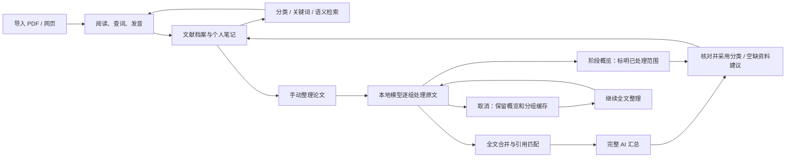

# PaperLingo v0.2 — 论文归档、个人笔记与检索

状态：已完成本机功能实现与流程验收；精细实验汇总的质量仍需迭代。目标机器：Apple M2 Pro / 32 GB。v0.1 的阅读、查词、语音和英语复习继续保留。

## 用户目标与主流程

导入论文 → 阅读与随手记录 → 整理成可回顾的论文档案 → 通过分类、关键词或语义搜索找回 → 从证据页继续阅读。

研究库与阅读空间分别承担管理和阅读。已有论文自动进入研究库；首次升级不批量触发 AI、不改动原论文、不覆盖旧词库或用户笔记。

## 每篇论文留下的记录

| 层次 | 记录 | 来源与修改规则 |
| --- | --- | --- |
| 文献信息 | 标题、作者、年份、会议/期刊、DOI、arXiv、来源、导入时间 | PDF 元数据或原文；缺失留空；用户可编辑 |
| 管理信息 | 分类、标签、待阅读/阅读中/已读/归档、收藏、最后阅读时间 | 用户维护；AI 分类建议需明确应用 |
| AI 汇总 | 一句话概括、研究问题、核心方法、贡献、实验/结论、局限、可借鉴之处 | 原文分段分析，保留生成模型、时间、覆盖范围和证据 |
| 原文证据 | 摘录、PDF 页码（网页为正文段落） | 必须在提供的原文片段中匹配；不接受模型编造引用 |
| 个人记录 | 想法、疑问、待办、复现笔记，可带选区和页码 | 独立保存；AI 重跑不覆盖 |
| 检索资料 | 提取正文、片段、全文索引、向量及模型标识 | 可重建派生数据，不替代原文件 |

不要求模型判断论文真实性、作者水平或泛化质量；汇总中的“结论”是论文报告内容，“可借鉴之处”明确作为 AI 提示，仍需用户判断。无文字层的 PDF 提示需 OCR，不生成伪汇总。

## 界面

- 新增侧栏入口「研究库」，包含搜索、状态/分类/标签筛选、收藏及列表。
- 论文详情包含「档案」「汇总」「笔记」；可打开原文、修改元信息、整理、查看证据和导出 Markdown。
- 阅读页可进入论文档案，或把当前选区保存为笔记。
- AI 整理显示提取、分段、汇总、索引等阶段及取消/失败重试，合并阶段显示层数和组数并推进进度；首组先返回带覆盖范围的阶段概览，全文完成后替换为完整汇总。阶段标记由应用控制，导出时也保留；生成内容不会直接覆盖手工分类。
- 关键词搜索无需模型；语义搜索通过显式搜索动作触发，展示片段、匹配来源与页码。
- 窄窗口优先保证列表和详情分别可操作，避免将多栏强行挤进阅读区。

阶段概览的状态由应用设置，模型不能自行宣布全文已完成。更新一份已有完整汇总时，后台处理不会先用阶段概览覆盖旧的完整结果。个人笔记始终与 AI 结果分开保存。

## 本地模型与内存

- 文本模型：`qwen3.6:27b-q4_K_M`，质量优先，约 18 GB；复用 Ollama，不引入另一套文本推理环境。
- 向量模型：`qwen3-embedding:0.6b`，Q8_0，约 639 MB，支持跨语言检索。
- 采用有限上下文的分段归纳，再汇总结构化 JSON；不把官方最大上下文当作本机配置。
- 同时只执行一个整理任务。大模型与嵌入推理分时执行，必要时暂停本应用的 OmniVoice 服务，完成或取消后恢复；不终止别的应用拥有的进程。
- 下载与运行先检查实际体积、剩余磁盘和就绪状态；模型未就绪时仍支持手工归档、笔记与关键词检索。
- 不承诺预设 tokens/s、完整论文延迟或质量指标，交付前用本机真实推理验证。

## 数据与可靠性

- SQLite 版本化迁移；升级前使用 SQLite 一致性备份，保留论文、词库及复习记录。
- 新增论文档案、笔记、正文片段、整理结果和搜索索引。避免通过替换 `papers` 表破坏旧引用。
- AI 输出按结构验证；引用须匹配真实文本。缺少依据的元信息留空，无效证据不做可点击引用。
- 个人记录即时进入关键词索引；向量携带模型/内容版本，防止用旧向量冒充新内容。
- Markdown 导出包含来源、汇总证据与个人笔记；备份仍使用完整数据目录。
- 原文件删除时清理相关派生索引与记录；删除前明确提示笔记影响。已有词库来源快照按 v0.1 规则保留。

## 实施顺序与验收

1. 数据迁移与核心类型：旧库升级、增删改、重启持久性、级联清理、备份可恢复。
2. 研究库与笔记：分类/状态/收藏、编辑、阅读页选区笔记、Markdown 导出，完成基本操作验收。
3. 本地模型：下载、就绪状态、分段整理、结构化输出、引用校验、取消与错误处理。
4. 检索：全文/笔记关键词、筛选、向量索引、中英文语义查询和原文页跳转。
5. 原生界面回归与本机真实模型验收：保留英语学习流程，更新 README、版本与验收记录。

此次交付本机自包含 app，并保留源码开发版本；不自动启用 GitHub Actions，不重新申请 GitHub 权限，不自动发布新的大型 DMG。安装版通过独立 APFS 副本包含模型，运行不依赖源码目录。

## 官方资料

- https://ollama.com/library/qwen3.6:27b
- https://huggingface.co/Qwen/Qwen3.6-27B
- https://ollama.com/library/qwen3-embedding:0.6b
- https://docs.ollama.com/capabilities/structured-outputs
- https://docs.ollama.com/api/embed
